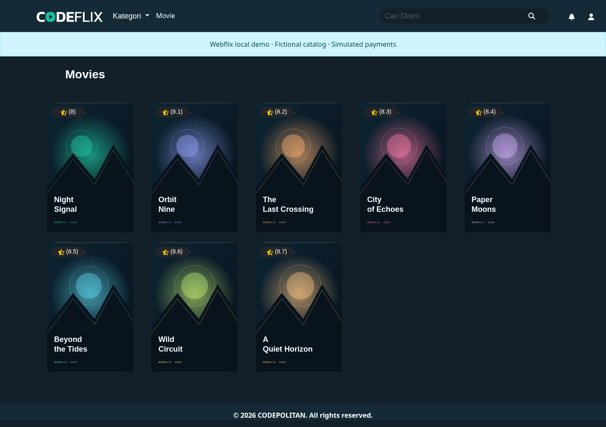
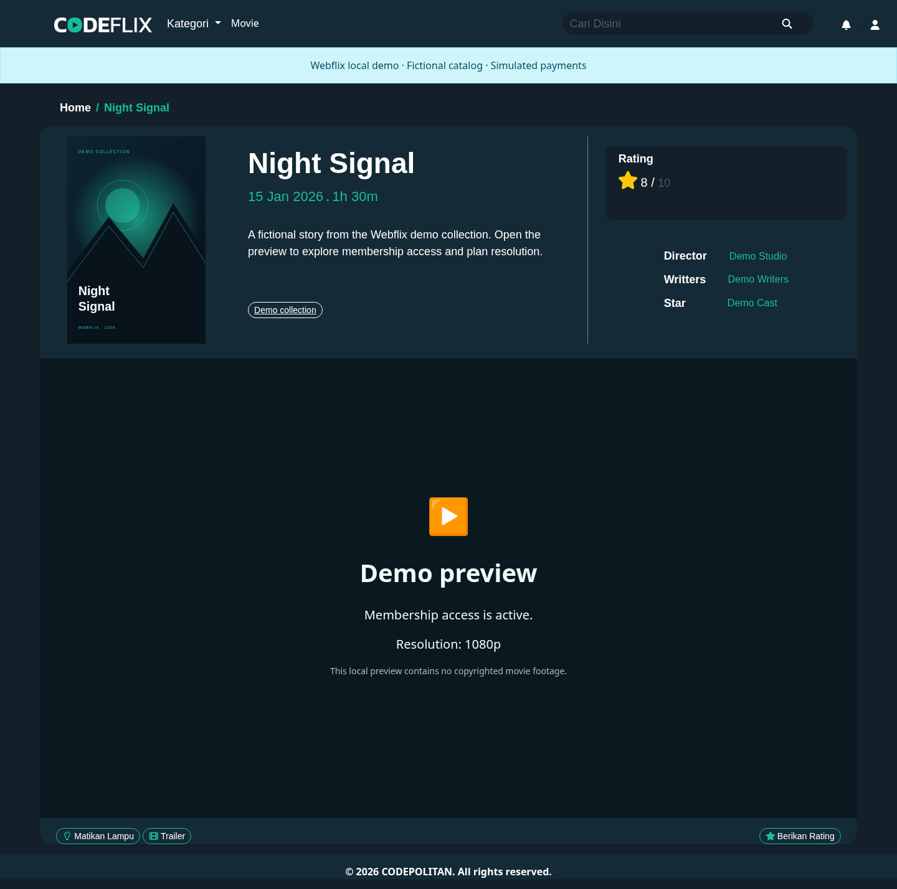
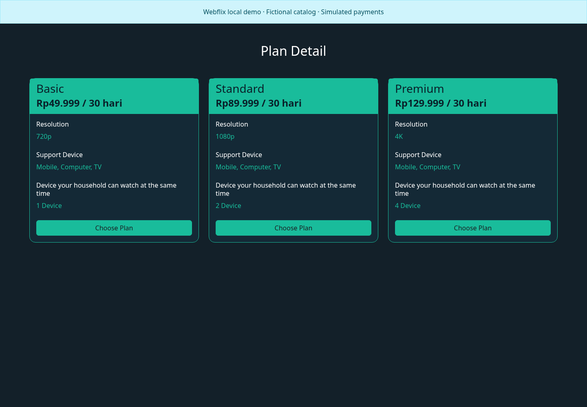
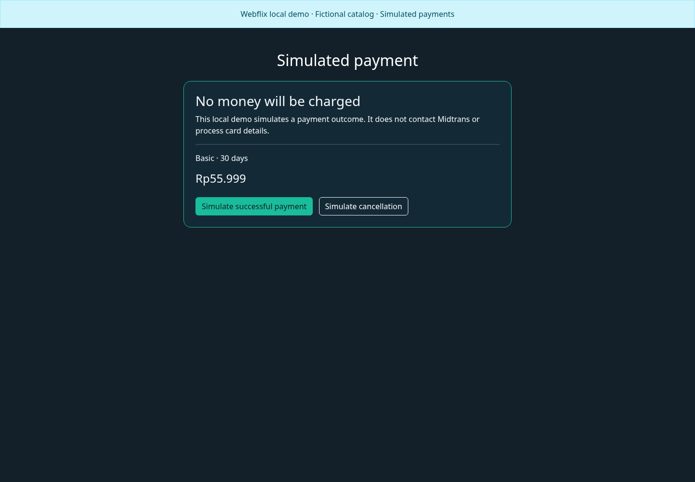
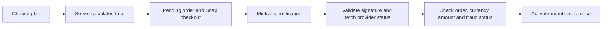

# Webflix

A Laravel movie-catalog and subscription application with plan-based playback, device limits, and Midtrans payment integration. The existing interface retains its Codeflix branding.

Built with Laravel 12, PHP 8.2+, Fortify, Blade, Bootstrap, Vite, and Swiper.

## Try the local demo

With Docker and Docker Compose installed:

```bash
git clone https://github.com/MirzaAlbab/webflix.git
cd webflix
docker compose -f compose.demo.yaml up --build
```

Open [http://localhost:8001](http://localhost:8001). The default demo uses fictional films, local posters, a membership-gated preview, and **simulated payments that charge no money**.

| Account | Initial state | Password |
| --- | --- | --- |
| `viewer@webflix.example` | Active Standard membership | `demo-password` |
| `new@webflix.example` | No membership | `demo-password` |
| `expired@webflix.example` | Expired membership | `demo-password` |

See [the demo guide](docs/DEMO.md) for workflows, setup without Docker, database resets, and optional real Midtrans sandbox configuration.

## Screenshots

### Fictional catalog



### Membership-gated preview



### Subscription plans



### Local simulated payment



## Features

- Authenticated movie catalog, search, categories, and ratings display.
- Plan-based playback resolution and device-registration limits.
- Server-calculated checkout totals with consistent 12% PPN and whole-rupiah rounding.
- Unique order IDs and stored checkout tokens.
- Signed notifications verified against Midtrans's authenticated status API before membership activation.
- Atomic activation, one membership per paid transaction, and duplicate-notification handling.
- Same-plan renewals retain remaining paid time; changing plans takes effect immediately.
- Playback checks membership start and expiry timestamps on each request.
- Expiry processing uses ID-based batches so updating records does not skip later memberships.

## Payment flow



The browser never decides the charged amount or grants membership. Both `/checkout` and the legacy `/subscribe/checkout` path create pending payments through the same handler. The receipt shows success only when the stored payment is verified.

## Local development

Install PHP compatible with `composer.lock`, Composer, Node.js, and npm. The Docker demo uses PHP 8.4 and Node.js 22.

```bash
composer install
cp .env.example .env
php artisan key:generate
npm ci
npm run build
```

Configure your database in `.env`, create the SQLite file if using SQLite, and then run:

```bash
php artisan migrate
php artisan serve
```

Run `npm run dev` in another terminal for frontend development. Midtrans server/client keys are configured in `.env`; use sandbox keys with `MIDTRANS_IS_PRODUCTION=false` during development. See [docs/DEMO.md](docs/DEMO.md) for callback configuration.

## Tests and CI

```bash
npm run build
php artisan test
```

PHP tests use in-memory SQLite and mocked provider responses. Coverage includes pricing tampering, authentication, callback signatures, authoritative status checks, amount/currency mismatches, replayed callbacks, renewals, receipt ownership, expiry boundaries, and guarded demo behavior.

With the simulated demo running:

```bash
npx playwright install chromium
npm run test:browser
```

Browser checks cover catalog/playback, registration, cancellation, successful checkout, and denial of unpaid or expired playback. GitHub Actions runs the frontend build, PHP tests, and browser checks on pull requests and pushes to `main`.

## Operations and schema

Run Laravel's scheduler and a queue worker for the scheduled `memberships:check` command when using a queued connection. Playback access expires immediately even before the cleanup job runs.

The payment migration adds a nullable, unique transaction reference to memberships and changes their start/end columns to timestamps. Existing date-only values retain midnight boundaries. Check historical expiry dates when applying this migration to an existing database.

Capture with accepted fraud status and settlement are recognized as paid; pending/challenged payments do not grant access. Denied, cancelled, and expired payments remain unpaid. Refund/partial-refund business policy is not implemented by this change.

The localhost demo is not production hosting. Actual streaming services should issue provider-protected playback URLs; this project selects configured URLs based on the current plan.

## Credits and license

The existing templates and assets retain Codeflix/CODEPOLITAN branding. Laravel, Fortify, Bootstrap, Swiper, Midtrans, and other dependencies retain their own licenses. The new demo catalog is fictional. No root project `LICENSE` file is included; contact the repository owner about application-code reuse.
